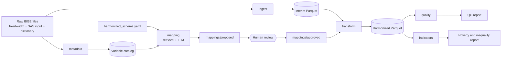

# Architecture

The diagram and component descriptions are completed as each phase lands.

Design principle: everything survey-specific lives in `config/surveys/*.yaml`
and `mappings/`; the code under `src/lacharm/` is survey-agnostic.
